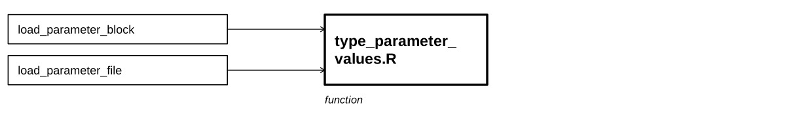

# type_parameter_values.R

**Function** &nbsp;·&nbsp; `30_Simulation/03_Functions/type_parameter_values.R`

## Function

Gives each raw value read from a parameter/value configuration file the type of its rule in the parameter catalogue. The type of each value follows its rule:

- Integer and Real : a number
- Options          : a number when every allowed option is a number (a 0/1 switch, for example), and text otherwise (an aim code, for example)
- Text             : text

Text values are returned without surrounding spaces.

## Called by

- [load_parameter_block.R](load_parameter_block.md)
- [load_parameter_file.R](load_parameter_file.md)

## What it calls, in order of appearance

- Nothing: this piece calls no other piece of the project.

## Input data

- raw_values : Named list. parameter name -> raw value, already validated.
- rules      : Data frame. The rows of the parameter catalogue of the file the values come from (columns parameter, type and options).

## Output data

- Named list. One element per raw value, in its order, in the type of its rule.

## Other notes from the file header

### Code outline

1. Convert each value by the type of its rule

### Usage instructions

```r
values <- type_parameter_values(raw_values, rules)
```

## Diagram



Also available as [type_parameter_values.svg](type_parameter_values.svg).

---

[Back to the code structure index](../Code_Structure.md)
