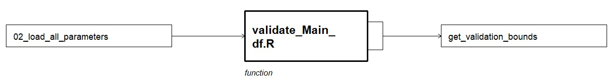

# validate_Main_df.R

**Function** &nbsp;·&nbsp; `30_Simulation/03_Functions/validate_Main_df.R`

## Function

This function performs structural and content validation of the main simulation data frame (Main_df) before it is used in the MPC simulation loop. Main_df is assembled by assemble_main_df.R from:

- 2 real input dataframes:
    - Meteo_df
    - Energy_Prices_df
- 3 synthetic dataframes:
    - System_df
    - Flexibility_actions_df
    - Meteo_transformations_df

It checks the following aspects:

1. That Main_df is a non-empty data frame.
2. That all required columns are present.
3. That the 'time' column is POSIXct, contains no NAs, and is strictly increasing.
4. That all non-time required columns are numeric.
5. That Occupancy and Scheduling are integer 0/1 flags and that the remaining binary flag columns contain only 0/1 values.
6. Soft physical range checks on Text and Elec_unit_cost_buy (warnings).
7. That SolarR contains no negative values (hard check).

## Called by

- [02_load_all_parameters.R](02_load_all_parameters.md)

## What it calls, in order of appearance

- [get_validation_bounds.R](get_validation_bounds.md) &nbsp;(2 call sites)

## Input data

- Main_df : Data frame. The main simulation data frame. It must contain every column of required_cols, the vector declared in block "Required columns (contractual interface)" of the body, which is the only list of them. By origin:
    - time
    - Meteo_df: the weather series
    - Energy_Prices_df: the energy and flexibility prices and the flexibility probabilities
    - System_df, with the columns of:
        - the thermal state (Ti, Te)
        - the context (Occupancy and Scheduling)
        - the setpoints and comfort
        - the heating and cooling actions
        - the thermal energy and the electricity
        - the flexibility commitment and phases
        - the economic results and the Reward

Most of them come in four versions:

- _exec: what was executed
- _plan: the plan
- _plan_flex_down: the downward flexibility itinerary
- _plan_flex_up: the upward flexibility itinerary
- Flexibility_actions_df: Flex_Act
- Meteo_transformations_df: T_ext_24h and the forecasts

Output columns are present from the start, to be filled during the simulation run.

- bounding_validation_config : Data frame. The plausibility bounds of the columns, from Validation_bounding_simulation.csv.

## Output data

- Invisibly returns TRUE if all checks pass.
- Prints a summary message with the number of rows and time span.

## Other notes from the file header

### Code outline

1. Check data frame structure
2. Check required columns
3. Validate time column
4. Validate numeric columns
5. Validate binary flag columns
6. Plausibility range checks

### Usage instructions

```r
validate_Main_df(Main_df, bounding_validation_config)
```

### Exceptions and special cases

- If Main_df is not a data frame, an error is raised via stop().
- If Main_df is empty (zero rows), an error is raised via stop().
- If any required column is missing, an error is raised listing all missing column names.
- If 'time' is not POSIXct, contains NAs, or is not strictly increasing, an error is raised via stop().
- If any non-time required column is not numeric, an error is raised listing the offending column names.
- If Occupancy or Scheduling are not integer 0/1 columns, an error is raised via stop().
- If a binary column contains values other than 0 or 1, an error is raised via stop(). The binary columns are:
    - Act_heat_exec
    - Act_cool_exec
- If Text is outside its plausibility bounds, a warning() is issued (soft check, simulation continues). The bounds are those of Validation_bounding_simulation.csv, not of this function.
- If Elec_unit_cost_buy falls below its plausibility bound, a warning() is issued (soft check, simulation continues). The bound is that of Validation_bounding_simulation.csv.
- A magnitude whose bound is empty on one side in Validation_bounding_simulation.csv is not checked on that side.
- If SolarR contains any negative value, an error is raised via stop().

## Diagram



Also available as [validate_Main_df.svg](validate_Main_df.svg).

---

[Back to the code structure index](../Code_Structure.md)
