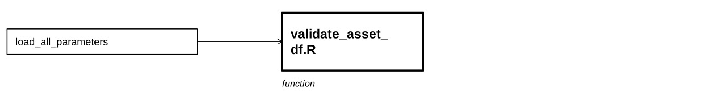

# validate_asset_df.R

**Function** &nbsp;·&nbsp; `30_Simulation/03_Functions/validate_asset_df.R`

## Function

Performs the structural and content validation of the table of an asset, assets[[asset_id]]$df, before it is prepared and used in the simulation loop. The table of an asset is generated from the variable registry of its type of model (for a building, Building_variables_df), one row per row of Main_df, and it is checked against the columns of its type. It checks:

1. That the table is a data frame with one row per row of Main_df.
2. That all required columns are present.
3. That its time column is the time column of Main_df, row by row.
4. That all non-time required columns are numeric.
5. That Occupancy and Scheduling are integer 0/1 flags, and that the activation columns Act_heat_exec and Act_cool_exec hold only 0, 1 or 2, for the flag columns that the type of the asset holds.

## Called by

- [load_all_parameters.R](load_all_parameters.md)

## What it calls, in order of appearance

- Nothing: this piece calls no other piece of the project.

## Input data

- asset_df      : Data frame. The table of the asset.
- time          : POSIXct vector. The time column of Main_df.
- required_cols : Character vector. The columns the assembled table of an asset of its type must hold: those of stage assembly and of the table of the type in 02_Needed_cols.csv, time included, as load_needed_columns() returns them for the type.
- asset_id      : Character scalar. The id of the asset, for the messages.

## Output data

- Invisibly returns TRUE if all checks pass.

## Other notes from the file header

### Code outline

1. Check the data frame and its rows
2. Check the required columns
3. Check the time column against Main_df
4. Validate numeric columns
5. Validate binary flag columns

### Usage instructions

```r
validate_asset_df(assets$Building_001$df, Main_df$time,
  parameters$asset_cols_assembly$Building,
  "Building_001")
```

### Exceptions and special cases

- Every check that fails stops the run with stop(), naming the asset.

## Diagram



Also available as [validate_asset_df.svg](validate_asset_df.svg).

---

[Back to the code structure index](../Code_Structure.md)
