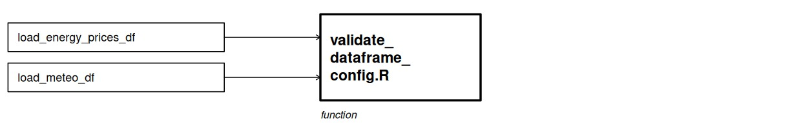

# validate_dataframe_config.R

**Function** &nbsp;·&nbsp; `30_Simulation/03_Functions/validate_dataframe_config.R`

## Function

Validates the columns of a data frame (e.g. Meteo_df, Energy_Prices_df) against the rules defined in a Validation_<name>.csv file, following the same file_name/parameter_name/type/output/options convention as Parameter_config.csv (see validate_parameter_config()), but applied to every value of a column vector instead of a single scalar. For each matching rule the function checks:

- Integer : column is numeric and every value is within [min, max]
- Real    : column is numeric and every value is within [min, max] (when options is set)

Validation failures trigger stop() for output == "Error" or warning() for output == "Warning".

## Called by

- [load_energy_prices_df.R](load_energy_prices_df.md)
- [load_meteo_df.R](load_meteo_df.md)

## What it calls, in order of appearance

- Nothing: this piece calls no other piece of the project.

## Input data

- df : the data frame to check.
- file_name : the name the validation table files its rules under, e.g. "Meteo_df.csv".
- validation_config : the table of rules, already read.

## Output data

- TRUE, invisibly, when every rule passes. Otherwise it stops, naming:
    - the column
    - the rule it broke
    - the offending value

## Other notes from the file header

### Arguments

df                Data frame. The loaded dataframe to validate

- (e.g. Meteo_df).

file_name         Character. Base name of the dataframe file, used

- to look up its validation rules (e.g.
- "Meteo_df.rds").

validation_config Data frame. Content of a Validation_<name>.csv

- file (same columns as Parameter_config.csv).

### Returns

invisible(TRUE) on success; stops on first Error-class failure.

### Code outline

1. Keep the rules filed under this file name, and return at once when there are none.
2. Check each rule against its whole column: the type, the range and, for an options rule, the allowed set.
3. Stop on the first breach, or warn, as the rule's output says.

### Usage instructions

```r
validate_dataframe_config(Meteo_df, "Meteo_df.csv", rules)
```

## Diagram



Also available as [validate_dataframe_config.svg](validate_dataframe_config.svg).

---

[Back to the code structure index](../Code_Structure.md)
