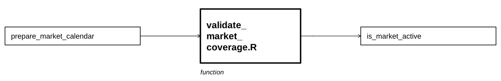

# validate_market_coverage.R

**Function** &nbsp;·&nbsp; `30_Simulation/03_Functions/validate_market_coverage.R`

## Function

Checks that every market interval of the simulation is covered by a market: the time step of every row of Main_df, except the first, has to fall in the control period (from Period_Begin to Period_End) of at least one Scheduling or Piloting market. A row holds the energy of the time step that ends at it, so a market covers the rows after Period_Begin up to the row at Period_End. A row that no market covers has no operation decided by anyone, so the market configuration is an input data error, and the run stops before the simulation. The first row is the initial condition of the simulation: it is never simulated, so it needs no market.

## Called by

- [prepare_market_calendar.R](prepare_market_calendar.md)

## What it calls, in order of appearance

- [is_market_active.R](is_market_active.md)

## Input data

- Main_df : Data frame. Must carry the time column (POSIXct) and, for each of the prefixes Sched and Pilot, the columns <prefix>_Market_Name, <prefix>_Market_Period_Begin and <prefix>_Market_Period_End, as written by build_market_timeline().

## Output data

- Invisible TRUE when every row is covered. Otherwise the run stops with an error that names the uncovered stretches.

## Other notes from the file header

### Code outline

1. Rows covered by each market
2. Verdict

### Usage instructions

```r
validate_market_coverage(Main_df)
```

## Diagram



Also available as [validate_market_coverage.svg](validate_market_coverage.svg).

---

[Back to the code structure index](../Code_Structure.md)
