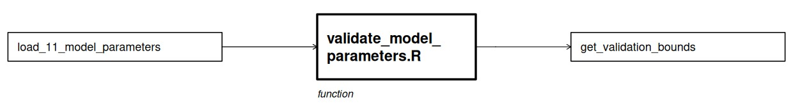

# validate_model_parameters.R

**Function** &nbsp;·&nbsp; `30_Simulation/03_Functions/validate_model_parameters.R`

## Function

This function validates the ventilation-related model parameters loaded from 11_Model_parameters.csv. It checks that Efi_Vent_Rec, Volume, and inertial_fact parameters exist and fall within their expected ranges. Invalid or missing values either stop the simulation (errors) or are replaced with safe defaults (warnings). RENvent01/RENvent1/RENvent2 are NOT re-validated here: they are already covered by Parameter_config.csv's authoritative hard-stop range check ([0, 20], Error level) applied at load time via read_and_validate_parameter_csv.R.

## Called by

- [load_11_model_parameters.R](load_11_model_parameters.md)

## What it calls, in order of appearance

- [get_validation_bounds.R](get_validation_bounds.md)

## Input data

- model_parameters : Named list. Model parameters as loaded from 11_Model_parameters.csv via load_11_model_parameters.R. Expected ventilation-related entries: Efi_Vent_Rec - Heat recovery efficiency (0-1) Volume      - Building volume (m3), must be positive inertial_fact - Thermal inertia factor (0-1)
- bounding_validation_config : Data frame. Content of Validation_bounding_simulation.csv, holding the plausibility bound below which the building volume is reported as unusually small.

## Output data

- model_parameters : Named list. The input list with any missing Efi_Vent_Rec or inertial_fact entries added and set to 0 (after issuing a warning). Volume errors cause the simulation to stop.

## Other notes from the file header

### Code outline

1. Validate Efi_Vent_Rec parameter
2. Validate Volume parameter
3. Validate inertial_fact parameter

### Usage instructions

```r
model_parameters <- validate_model_parameters(model_parameters, bounding_validation_config)
```

## Diagram



Also available as [validate_model_parameters.svg](validate_model_parameters.svg).

---

[Back to the code structure index](../Code_Structure.md)
