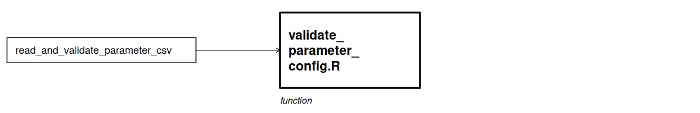

# validate_parameter_config.R

**Function** &nbsp;·&nbsp; `30_Simulation/03_Functions/validate_parameter_config.R`

## Function

Validates a named list of parameter values against the rules defined in Parameter_config.csv for a given file name. For each matching rule the function checks:

- Integer : value is numeric, whole number, and within [min, max]
- Real    : value is numeric and within [min, max] (when options set)
- Options : as.character(value) is one of the allowed options
- Text    : no additional constraint beyond existence

Validation failures trigger stop() for output == "Error" or warning() for output == "Warning".

## Called by

- [read_and_validate_parameter_csv.R](read_and_validate_parameter_csv.md)

## What it calls, in order of appearance

- Nothing: this piece calls no other piece of the project.

## Input data

- values : the named list of values read from a configuration file.
- file_name : the name the validation table files its rules under, e.g. "02_Control.csv".
- validation_config : Parameter_config.csv, already read.

## Output data

- TRUE, invisibly, when every rule passes. Otherwise it stops, naming:
    - the parameter
    - the rule it broke
    - its value

## Other notes from the file header

### Arguments

values            Named list. parameter_name -> raw value (character

- or numeric) as read from the CSV file.

file_name         Character. Base name of the config file

- (e.g. "11_Model_parameters.csv").

validation_config Data frame. Content of Parameter_config.csv.

### Returns

invisible(TRUE) on success; stops on first Error-class failure.

### Code outline

1. Keep the rules filed under this file name, and return at once when there are none.
2. Check each rule against its one value: the type, the range and, for an options rule, the allowed set.
3. Stop on the first breach, or warn, as the rule's output says.

### Usage instructions

```r
validate_parameter_config(values, "02_Control.csv",
  validation_config)
```

## Diagram



Also available as [validate_parameter_config.svg](validate_parameter_config.svg).

---

[Back to the code structure index](../Code_Structure.md)
