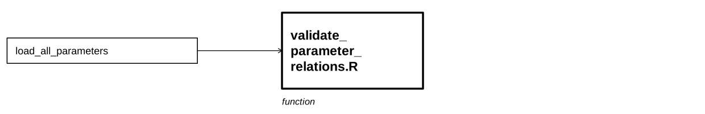

# validate_parameter_relations.R

**Function** &nbsp;·&nbsp; `30_Simulation/03_Functions/validate_parameter_relations.R`

## Function

Checks the relations two parameters have to keep with each other, which the range of each one cannot express: a low end below its high end, two operating points in order, a horizon that fits in another. The relations are the rows of Validation_parameter_relations.csv, each one read as

- left (+ gap) relation right

A parameter is found in parameters by its name, which is unique across the sub-lists; a column of a table (such as the heating setpoint of the modes) is checked on every row of the table. The parameters of an asset are held by its entry of parameters$assets, so the relations are checked once per asset: a name is looked for first in the groups of the asset, and then in the other sub-lists of parameters. A relation between a parameter of the asset and one of the system is so checked for every asset. The setpoints of the modes and the Deadband are both parameters of the building, found in its groups. A relation applies to an asset when its asset_type is "-" or the type of the asset. A relation is also checked against 04_File_paths.csv: every file it names must be listed there, as a file of the system or of the type of the relation, and its asset_type must be "-" or a type of that table. A relation that does not apply to an asset is not checked for it. Within a relation that applies, a parameter that is not found stops the run. Every relation is checked, and the run stops listing all of those that fail, so that a configuration is corrected in one pass. With more than one asset, each failure names its asset.

## Called by

- [load_all_parameters.R](load_all_parameters.md)

## What it calls, in order of appearance

- Nothing: this piece calls no other piece of the project.

## Input data

- parameters : Named list. Every parameter, already loaded, with the parameters of each asset in parameters$assets.
- relations  : Data frame. Content of Validation_parameter_relations.csv, without its comment rows and its units row, with the columns:
    - left_file, left_parameter
    - relation
    - right_file, right_parameter
    - gap_file, gap_parameter
    - asset_type
- file_paths_table : Data frame. Content of 04_File_paths.csv, with the columns key, scope and filename, as given by read_file_paths_table().

## Output data

- TRUE, invisibly, when every relation holds. Otherwise it stops, naming each relation that fails and the values it found.

## Other notes from the file header

### Code outline

1. Find a parameter, or a column of a table, by its name
2. Check each relation, for each asset
3. Stop when any fails

### Usage instructions

```r
validate_parameter_relations(
  parameters       = parameters,
  relations        = relations,
  file_paths_table = file_paths_table
  )
```

## Diagram



Also available as [validate_parameter_relations.svg](validate_parameter_relations.svg).

---

[Back to the code structure index](../Code_Structure.md)
