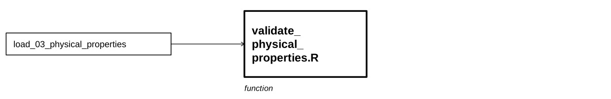

# validate_physical_properties.R

**Function** &nbsp;·&nbsp; `30_Simulation/03_Functions/validate_physical_properties.R`

## Function

This function validates the physical properties loaded from 03_Physical_properties.csv. Their presence and range, and those of the reference values of Validation_03_Physical_properties.csv, are already checked at Error level against the parameter catalogue by read_and_validate_parameter_csv(). What is left here:

- Cp_air and dens_air must be strictly positive: their ranges in the parameter catalogue include 0.
- A warning is raised if their values differ from the reference values held in Validation_03_Physical_properties.csv. The reference values are read from that file rather than written here, so the standard properties of air are stated once, where the rest of the configuration is.
- The reference conditions of photovoltaic modules (the standard test conditions and the conditions of the NOCT) and the solar constant are checked only against their reference values: a warning is raised if one differs, because a change of them changes the meaning of the catalogue data of the modules or the radiation the sun can give.

## Called by

- [load_03_physical_properties.R](load_03_physical_properties.md)

## What it calls, in order of appearance

- Nothing: this piece calls no other piece of the project.

## Input data

- physical_properties : Named list. Physical properties loaded from 03_Physical_properties.csv via load_03_physical_properties.R. Expected entries: Cp_air   - Specific heat of air (kJ/kg·K) dens_air - Density of air (kg/m3) PV_STC_irradiance PV_STC_cell_temperature PV_NOCT_irradiance PV_NOCT_ambient_temperature Solar_constant
- reference_values    : Named list. Reference values loaded from Validation_03_Physical_properties.csv by load_03_physical_properties.R. Expected entries: Cp_air_ref, dens_air_ref, and the _ref value of each reference condition of the photovoltaic modules and of Solar_constant.

## Output data

- Invisibly returns TRUE if all checks pass.
- Raises an error (stop) if a parameter is non-positive. Issues a warning if values differ from their reference values.

## Other notes from the file header

### Code outline

1. Validate Cp_air
2. Validate dens_air
3. Compare the reference conditions of photovoltaic modules and the solar constant

### Usage instructions

```r
validate_physical_properties(physical_properties, reference_values)
```

### Exceptions and special cases

- The comparison carries no tolerance. A configured value that differs from its reference in any digit raises a warning, and the simulation continues with the configured value.

## Diagram



Also available as [validate_physical_properties.svg](validate_physical_properties.svg).

---

[Back to the code structure index](../Code_Structure.md)
