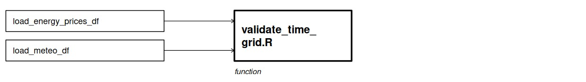

# validate_time_grid.R

**Function** &nbsp;·&nbsp; `30_Simulation/03_Functions/validate_time_grid.R`

## Function

Validates that a 'time' vector is a well-formed, equispaced POSIXct series whose own step is compatible with Main_df's target resolution (main_resolution_sec, as configured in 01_computing_parameters.csv). The step itself is NOT assumed to be any particular value (e.g. 1h or 15') - that is only the resolution of the current dataset, not a requirement; any equispaced step that is a multiple of main_resolution_sec is accepted.

## Called by

- [load_energy_prices_df.R](load_energy_prices_df.md)
- [load_meteo_df.R](load_meteo_df.md)

## What it calls, in order of appearance

- Nothing: this piece calls no other piece of the project.

## Input data

- time               : POSIXct vector. Timestamps to validate.
- file_name          : Character. Name of the file this series comes from, used in error messages.
- main_resolution_sec : Numeric. Target resolution of Main_df, in seconds. Has no default: the caller passes parameters$computing$main_resolution_sec, so this function never holds a second definition of the simulation's time step.

## Output data

- Numeric scalar. The detected step (seconds) of this series.

## Other notes from the file header

### Exceptions and special cases

- If time is not POSIXct, stop().
- If time has fewer than 2 rows, stop() (a step cannot be detected).
- If time is not strictly equispaced, stop() indicating the first row where the step changes.
- If the detected step is not a positive multiple of main_resolution_sec, stop().
- If the series origin (time[1]) does not fall on the main_resolution_sec grid, stop().

### Code outline

1. Check the column is POSIXct and has at least two rows.
2. Check the step is the same everywhere, naming the first row where it is not.
3. Check that step is the master resolution.

### Usage instructions

```r
validate_time_grid(df$time, "Meteo_df.csv", main_resolution_sec)
```

## Diagram



Also available as [validate_time_grid.svg](validate_time_grid.svg).

---

[Back to the code structure index](../Code_Structure.md)
