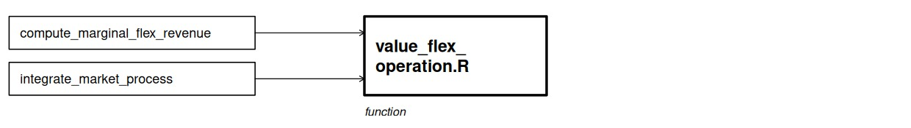

# value_flex_operation.R

**Function** &nbsp;·&nbsp; `30_Simulation/03_Functions/value_flex_operation.R`

## Function

Resolves the move of an explicit flexibility commitment from E_orig to E_new into its down/up legs and their sold/bought-back volumes and cash flow.
Why this is not calc_differential_cost()/split_market_operation() Energy has a single position that can flip sign (a net importer can become a net exporter), and "growing the positive leg" is always a purchase. Explicit flexibility is different: it is a service the building SELLS to the grid, in two independent, always non-negative legs - down-flexibility (Elec_flex_down_plan > 0, a promise to reduce load) and up-flexibility (Elec_flex_down_plan < 0, a promise to increase it). Growing either leg is a SALE (income), and shrinking it is a BUY BACK (expense) - the opposite polarity of calc_differential_cost()'s "growing the positive leg = a purchase" convention. Passing E_orig/ E_new through that machinery would price a growing down-flexibility commitment as an expense instead of income. The two legs are told apart by the sign of the series given here, and the caller decides which leg a series belongs to: the down leg carries Elec_flex_down_plan as it is, and the up leg carries Elec_flex_up_plan negated. Both signals are non-negative by construction and each is passed in its own call, so a call only ever activates one leg and a downward commitment can never cancel an upward one.

## Called by

- [compute_marginal_flex_revenue.R](compute_marginal_flex_revenue.md)
- [integrate_market_process.R](integrate_market_process.md)

## What it calls, in order of appearance

- Nothing: this piece calls no other piece of the project.

## Input data

- E_orig, E_new : Numeric vectors, same length. Explicit flexibility commitment before/after the change, for one or more target slots: Elec_flex_down_plan for the down leg, -Elec_flex_up_plan for the up leg.
- The four prices below are numeric vectors, same length as E_orig:
- the effective price (commitment + execution, weighted by activation probability) of selling/buying back the down/up leg in each target slot.
    - price_down_sell
    - price_down_buy
    - price_up_sell
    - price_up_buy

## Output data

- Named list of five numeric vectors, all the same length as E_orig:
    - down_sold, down_bought : >= 0. Volume sold or bought back on the downward leg.
    - up_sold, up_bought : >= 0. The same on the upward leg.
    - revenue : Net cash flow (positive = income, negative = expense) - down_sold*price_down_sell + up_sold*price_up_sell - down_bought*price_down_buy - up_bought*price_up_buy.

## Other notes from the file header

### Code outline

1. Down/up legs before and after
2. Sold/bought-back volume on each leg
3. Net cash flow

### Usage instructions

```r
op <- value_flex_operation(E_orig, E_new, price_down_sell, price_down_buy, price_up_sell, price_up_buy)
```

## Diagram



Also available as [value_flex_operation.svg](value_flex_operation.svg).

---

[Back to the code structure index](../Code_Structure.md)
