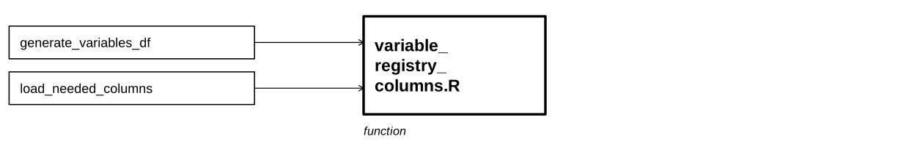

# variable_registry_columns.R

**Function** &nbsp;·&nbsp; `30_Simulation/03_Functions/variable_registry_columns.R`

## Function

Reads a declarative variable registry, Simulation_Variables_<name>.txt, and returns the columns it declares, in the order of the registry. There is one registry for the system (00_System/Simulation_Variables_System.txt), whose columns Main_df holds, and one for each type of model of an asset (for a building, 01_Building/Simulation_Variables_Building.txt), whose columns the table of each asset of that type holds. It is the one place where a variable of a registry is turned into its columns:

- scenario == "yes": four columns, <variable>_exec, <variable>_plan, <variable>_plan_flex_down and <variable>_plan_flex_up. The last two are the two flexibility itineraries: downward (load reduction) and upward (load increase).
- scenario == "no": one column, <variable>, with no suffix.

Both the tables generated from a registry and the list of the columns of the simulation data read the columns from here, so the registry is the only file that declares them.

## Called by

- [generate_variables_df.R](generate_variables_df.md)
- [load_needed_columns.R](load_needed_columns.md)

## What it calls, in order of appearance

- Nothing: this piece calls no other piece of the project.

## Input data

- registry_path : Character. Path to a Simulation_Variables_<name>.txt file, tab-separated, with the columns:
    - variable
    - type
    - initial_value
    - scenario

## Output data

- Data frame, one row per column the registry declares, in registry order, with the columns:
    - column        : Character. The name of the column.
    - variable      : Character. The variable of the registry.
    - initial_value : Numeric. The initial value of the variable.
    - scenario      : Character. "yes" when the variable is expanded into the four itineraries, "no" otherwise.

## Other notes from the file header

### Code outline

1. Read the variable registry and check its columns
2. Check every scenario flag is yes or no
3. Expand every variable into its columns

### Usage instructions

```r
columns <- variable_registry_columns(paths$building_variables_file)
```

### Exceptions and special cases

- If the registry file is missing any required column, stop(). The required columns are those listed under Inputs.
- If scenario contains a value other than "yes"/"no", stop().

## Diagram



Also available as [variable_registry_columns.svg](variable_registry_columns.svg).

---

[Back to the code structure index](../Code_Structure.md)
