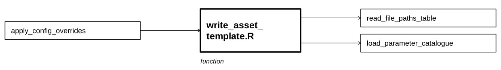

# write_asset_template.R

**Function** &nbsp;·&nbsp; `30_Simulation/03_Functions/write_asset_template.R`

## Function

Writes the configuration folder of an asset, with the files of its type of model, from the default values. The folder is named by the asset id inside the folder of the assets (the file of the key asset_config_folder in 00_Inner_parameters/04_File_paths.csv), and the files are the rows of the file paths table whose scope is the type of the asset. There is no template folder: a file that has a default version in 00_Validation/ (Default_<file>) is copied from it, and any other file is written as a flat parameter,value,unit file from the default column of the parameter catalogue, in the order of the catalogue, with the blocks of the catalogue as comment lines. A file that has a default version and also parameters with a default value in the catalogue holds a block of parameters above its table: it is written as the block of those parameters, one blank line, and the default version, which is its table.

## Called by

- [apply_config_overrides.R](apply_config_overrides.md)

## What it calls, in order of appearance

- [read_file_paths_table.R](read_file_paths_table.md)
- [load_parameter_catalogue.R](load_parameter_catalogue.md)

## Input data

- config_path : Character. Path of the configuration folder, the one that holds 00_Inner_parameters/.
- asset_id    : Character. The id of the asset, for example "Building_001".
- asset_type  : Character. The type of model of the asset, for example "Building".

## Output data

- Character. The path of the folder written. The run stops, naming the asset, if the folder already exists, if the type has no file in the table, or if a file has neither a default version nor a default value for each of its parameters in the catalogue.

## Other notes from the file header

### Code outline

1. Read the table of file names and select the files of the type
2. Prepare the content of each file
3. Write the folder

### Usage instructions

```r
write_asset_template(
  config_path = file.path("30_Simulation", "02_Config"),
  asset_id    = "Building_002",
  asset_type  = "Building"
  )
```

## Diagram



Also available as [write_asset_template.svg](write_asset_template.svg).

---

[Back to the code structure index](../Code_Structure.md)
