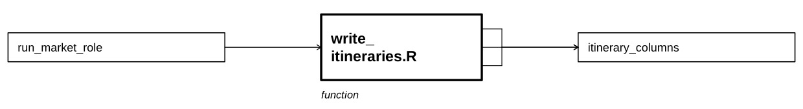

# write_itineraries.R

**Function** &nbsp;·&nbsp; `30_Simulation/03_Functions/write_itineraries.R`

## Function

Works out how the decision of a single Scheduling or Piloting market is written into the tables of the simulation, for the current simulation step. The market writes the plan it ends with, the two flexibility itineraries and the commitments of the two legs (Elec_flex_down_plan and Elec_flex_up_plan), as absolute values on the rows it controls. The plan and the two flexibility itineraries of each asset are written into the table of that asset; the commitments belong to the system, and are written into Main_df. The function never writes into Main_df: it returns the writes, and the simulation loop (run_market_role()) applies them. The settlement of the market (settle_market()) reads the energy of these itineraries once the writes are applied. The phase codes are the optimizer's own labels: scratch state of the search, reset on every candidate by derive_flex_itineraries(). They are not written back. The settlement commits the energy of the _plan itinerary and the phase-1 flexibility, and neither needs the label, because the contingent recovery is not committed.

## Called by

- [run_market_role.R](run_market_role.md)

## What it calls, in order of appearance

- [itinerary_columns.R](itinerary_columns.md) &nbsp;(3 call sites)

## Input data

- piece               : List. The piece of the market, as returned by run_market_process(): the table of the system and the table of each asset, with the columns of the plan, of the two flexibility itineraries and of the commitments for the market's period.
- simulation_control  : Named list. Must contain indexes_global$idx_ctrl and indexes_local$idx_ctrl for the current market.
- parameters          : Named list. Model parameters; reads the variables of the itineraries through itinerary_columns().

## Output data

- Named list with:
    - system : List of writes for Main_df: the commitments of the two legs.
    - assets : Named list, one element per asset, in the order of the asset registry. Each one is the list of writes for the table of that asset: its plan and its two flexibility itineraries.
- The writes of each list are in the order in which they have to be applied. Each write is a list with:
    - column : Character. Column of the table written.
    - rows   : Integer vector. Rows of the table (the control rows).
    - value  : Numeric vector, as long as rows.
    - mode   : Character. "assign": the values replace the current ones.
- There is one write per column of the plan, of the two flexibility itineraries and of the commitments that the tables of the piece hold.

## Other notes from the file header

### Code outline

1. Columns of the itineraries and the commitments
2. Absolute writes over the control rows

### Usage instructions

```r
itinerary_writes <- write_itineraries(
  piece              = market_piece,
  simulation_control = simulation_control,
  parameters         = parameters
  )
```

## Diagram



Also available as [write_itineraries.svg](write_itineraries.svg).

---

[Back to the code structure index](../Code_Structure.md)
