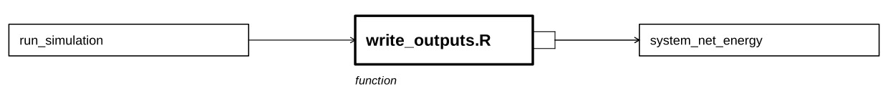

# write_outputs.R

**Function** &nbsp;·&nbsp; `30_Simulation/03_Functions/write_outputs.R`

## Function

This function exports the simulation results to CSV and RDS files: the table of the system, the table of each asset, a summary and the economic analysis tables.

## Called by

- [run_simulation.R](run_simulation.md)

## What it calls, in order of appearance

- [system_net_energy.R](system_net_energy.md) &nbsp;(2 call sites)

## Input data

- Main_df           : Data table. Simulation results of the system, with the common columns.
- assets            : Named list, one entry per asset, each with df, the table of the asset.
- system_columns    : Character vector. The order of the columns of Main_df_computed (parameters$needed_cols).
- asset_columns     : Named list, one element per type of model, each a character vector. The order of the columns of the table of the assets of the type (parameters$asset_cols).
- asset_types       : Named character vector. The type of model of each asset, named by asset_id.
- economic_analysis : List of 3 data frames (market, decision, slot), as completed by finalize().
- execution_time    : List. Timing information of the simulation.
- optimization      : List. The optimization parameters (parameters$optimization).
- output_path       : Character. Path of the output directory, created when it does not exist.

## Output data

- output_path, returned invisibly. The function writes the tables below to it, each as .csv and .rds:
    - Main_df_computed
    - <asset_id>_df_computed, one per asset
    - Sinthetized_df_computed
    - Economic_analysis_market_computed
    - Economic_analysis_decision_computed
    - Economic_analysis_slot_computed

## Other notes from the file header

### Main_df_computed

Main_df as it is: what is common to every asset (time, weather, prices and the market timeline) and the columns of the system (the net electricity Elec_total_<itinerary>, summed over the assets, the commitments and the money flows). One row per timestep. The columns are in the order of 02_Needed_cols.csv (the rows whose table is system); a column not in that file goes after them.

### The table of each asset

One table per asset of the registry, named <asset_id>_df_computed (Building_001_df_computed for the building): the table of the asset as it is. The column time comes first, then the columns of the asset in the order of 02_Needed_cols.csv (the rows whose table is the type of model of the asset); a column not in that file goes after them. It has one row per row of Main_df_computed, in the same order, so both tables join by time. Elec_total_<itinerary> in it is the net electricity of the asset, and Main_df_computed holds the sum over the assets.

### Sinthetized_df

One row per simulation, reconstructable in full from its own columns: every money column follows the repository's sign convention (income positive, expense negative), so Elec_cost + Elec_revenue + Flex_plan_revenue + Distr_cost is the energy-and-flexibility economic result of the year, before comfort. The market-decision (Scheduling/Piloting) and execution-deviation money flows are not split apart into their own columns here - the per-market, per-decision and per-slot breakdown is economic_analysis$market, economic_analysis$decision and economic_analysis$slot, exported separately below.

- Comfort             = sum(Comfort_exec) over every asset whose table holds it, 0 when there is none: timesteps in comfort.
- Elec_total_in       = sum(pmax(Elec_total_exec, 0)): energy imported.
- Elec_total_out      = sum(pmax(-Elec_total_exec, 0)): energy exported.
- Flex_plan_down      = sum(Elec_flex_down_plan): down-flexibility committed.
- Flex_plan_up        = sum(Elec_flex_up_plan): up-flexibility committed. Each leg has its own signal, and both are non-negative by construction, so neither is read off the sign of the other.
- Flex_exec_down/up   = the same two legs, restricted to timesteps where flexibility was actually executed (never true today: flexibility execution is not simulated, so both are always 0; see finalize()'s identical logic).
- Elec_cost           = -sum(economic_analysis$slot$Cost_energy_bought): net spent buying energy, across Scheduling, Piloting and Execution, with every resale subtracted as the avoided cost it is.
- Elec_revenue        = sum(economic_analysis$slot$Revenue_energy_sold): net received selling energy, with every rebuy subtracted as the avoided revenue it is. A simulation that never exports therefore reports Elec_revenue = 0, instead of counting its resales as income - see accumulate_market_operation()'s header.
- Flex_plan_revenue   = sum(economic_analysis$slot$Revenue_flex_commitments): net cash flow of flexibility commitments (sold minus bought back), across Scheduling and Piloting.
- Flex_exec_revenue   = sum(economic_analysis$market$Flex_executed_cash_flow) on Execution rows: always 0 today, for the same reason as Flex_exec_down/up.
- Distr_cost          = sum(economic_analysis$slot$Distribution_cost): already negative (see settle_execution.R).
- Reward              = sum(economic_analysis$decision$Reward): the GA's own optimization target, totalled over every decision.
- Process_time        = execution_time$t_process (seconds).

The optimization parameters are kept as the leading columns, so that parametric-simulation batches can be compared by hyperparameter.

### Code outline

1. Create output directory if needed
2. Check the tables of the assets
3. Export Main_df_computed
4. Export the table of each asset
5. Build and export synthesized summary data frame
6. Export the three economic analysis tables
7. Return the output path

### Usage instructions

```r
write_outputs(
  Main_df           = Main_df,
  assets            = assets,
  system_columns    = parameters$needed_cols,
  asset_columns     = parameters$asset_cols,
  asset_types       = asset_types,
  economic_analysis = economic_analysis,
  execution_time    = execution_time,
  optimization      = parameters$optimization,
  output_path       = paths$output_path
  )
```

## Diagram



Also available as [write_outputs.svg](write_outputs.svg).

---

[Back to the code structure index](../Code_Structure.md)
