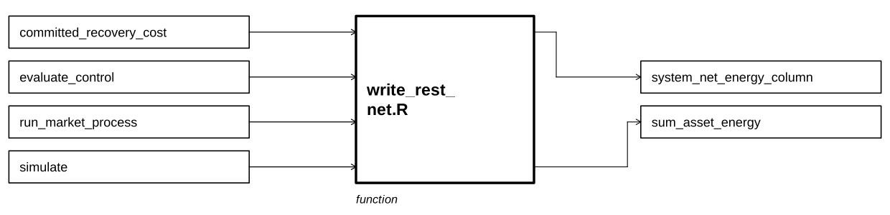

# write_rest_net.R

**Function** &nbsp;·&nbsp; `30_Simulation/03_Functions/write_rest_net.R`

## Function

Writes, in the view of an asset that reads the net electricity of the rest of the system (the operation reads_rest_net of its contract), the column Elec_rest of an itinerary: on each row, the sum of the electricity of the assets that have already been simulated, in the order of asset_simulation_order(). It is the only place where the name of the column is written. The sum is that of sum_asset_energy(), and it is 0 on each row when no asset has been simulated yet.

## Called by

- [committed_recovery_cost.R](committed_recovery_cost.md)
- [evaluate_control.R](evaluate_control.md)
- [run_market_process.R](run_market_process.md)
- [simulate.R](simulate.md)

## What it calls, in order of appearance

- [system_net_energy_column.R](system_net_energy_column.md)
- [sum_asset_energy.R](sum_asset_energy.md)

## Input data

- view      : Data frame. The view of the asset, with the column Elec_rest_<itinerary>.
- assets    : Named list, one entry per asset, each with df, its table. The tables of the assets in asset_ids hold the electricity of the itinerary.
- asset_ids : Character vector. The assets simulated before this one. It may be empty.
- itinerary : Character scalar. One of "exec", "plan", "plan_flex_down" and "plan_flex_up".
- rows      : Integer vector. The rows of the tables of the assets that correspond to the rows of the view, in order.

## Output data

- Data frame. The view with Elec_rest_<itinerary> written on every row (kWh, positive when the rest imports). The run stops if rows does not have as many elements as the view has rows.

## Other notes from the file header

### Code outline

1. Check the rows
2. Add the electricity of the assets simulated before
3. Write the column

### Usage instructions

```r
view <- write_rest_net(
  view      = view,
  assets    = piece$assets,
  asset_ids = c("Building_001", "Photovoltaic_001"),
  itinerary = "plan",
  rows      = seq_len(nrow(view))
  )
```

## Diagram



Also available as [write_rest_net.svg](write_rest_net.svg).

---

[Back to the code structure index](../Code_Structure.md)
